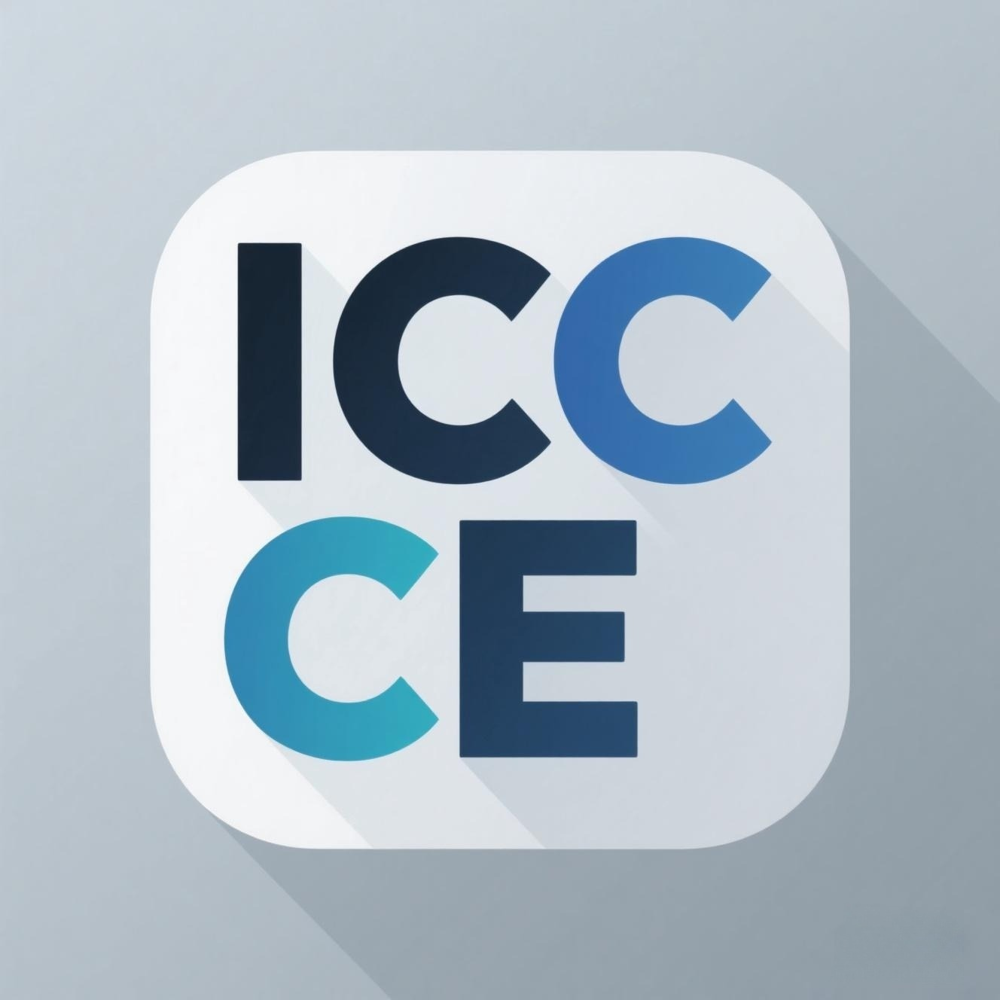

# InkCanvasForClass Community Edition

The final stance of stubbornness based on the `InkCanvas` control...

## 💫 Software Disclaimer

By using this version of InkCanvasForClass, you agree to assume all potential issues and risks at your own discretion. It is highly recommended NOT to use Beta versions—which haven't been extensively tested and optimized—in public or formal settings (e.g., open classes, recorded courses, live streams, major conferences). Any consequences, issues, or risks arising from using Beta versions (e.g., getting scolded by your homeroom teacher, penalized by the principal, chaotic scenes caused by software crashes, global sea level rise, etc.) **shall be borne solely by the user**. [CJKmkp](https://github.com/CJKmkp) and all project maintainers provide no warranties or guarantees whatsoever.

♥️ **The copyright of this project belongs to [CJKmkp](https://github.com/CJKmkp) and its contributors. This project is released under GPL-3.0 without additional restrictions; see [License](#license).**

**Smart Education Alliance InkCanvasForClass Community Edition Section:** [forum.smart-teach.cn/t/icc-ce](https://forum.smart-teach.cn/t/icc-ce). This is where we post version update logs. You are also welcome to ask questions or share your experience here, provided you comply with the forum management rules and the section's terms of service.

## ⚠️ Important Notice

Before using and distributing this software, please make sure you understand the relevant open-source licenses. This software is modified based on <https://github.com/InkCanvasForClass/icc-20240610-stable>, which in turn is modified based on <https://github.com/ChangSakura/Ink-Canvas>. Meanwhile, ICA is based on <https://github.com/WXRIW/Ink-Canvas> with additional features including, but not limited to, hiding to the sidebar, alongside modified UI and software interaction logic. For feedback regarding ink writing functionality or features unique to ICA, it is recommended to check <https://github.com/WXRIW/Ink-Canvas/issues> first. **Please bring your brain along before using.**

# 💬 Tips & Notes

- For constructive feedback and reasonable suggestions on new features, developers will respond and implement them in due course. This software is neither commercial nor driven by any profit-seeking organization. Please do not rush the developers; patience leads to fewer bugs and a more stable experience.
- This software is released under GPL-3.0, which permits commercial use; if you distribute it commercially, please comply with GPL-3.0 (publish the corresponding source code, keep the copyright notices, etc.). Updates won't be exceptionally frequent. If you have the capability, please contribute code via Pull Requests instead of throwing an impotent rage in the Issues section.
- Welcome to try out other members of the InkCanvas family, including [Ink Canvas Plus](https://khyan.top/ic+) and [Ink Canvas Artistry](https://github.com/InkCanvas/Ink-Canvas-Artistry). Your word-of-mouth promotion will help more users discover our software.
- **It is strongly recommended to use InkCanvasForClass alongside Microsoft Office 365 PowerPoint for the best performance and compatibility!!!**

## 📗 FAQ

### Why do some icons show up as "□" on systems below Windows 10?

[Click here to download](https://aka.ms/SegoeFonts "SegoeFonts") the SegoeFonts files. Install the `SegMDL2.ttf` font from the zip archive and restart your system to resolve the issue.

### The application crashes immediately upon turning a page in PowerPoint slideshow mode

Please [activate Microsoft Office](https://www.coolhub.top/archives/14).

### The canvas application does not switch to PPT mode after starting the slideshow

1. PowerPoint is running in Protected View (Read-Only). Please exit Protected View by doing the following:
   1. Open PowerPoint and click "File" in the top-left corner.
   2. In the "Info" tab, click the "Enable Editing" button on the right.
2. WPS Office was previously installed, which corrupted the COM components. To fix this, completely uninstall WPS Office and reinstall Microsoft Office Mondo 2016.
3. Ensure both PowerPoint and this application are running with the same permission levels. If PowerPoint runs as Administrator while this app runs as a standard user, it will fail to switch to PPT mode. You can fix this by checking PowerPoint's compatibility settings or running this application with elevated privileges.
4. If none of the above methods work, please refer to this link: [【Click here to redirect】](https://www.inkeys.top/tutorial/ppt-com.html)

### The application fails to launch normally

Please check if `.Net Runtime 6.0` or higher is installed on your computer. If not, please [visit the official website](https://dotnet.microsoft.com/en-us/download/dotnet/6.0) to download and install it.

If it still doesn't run, please [install `Microsoft Office`](https://www.coolhub.top/archives/11).

## ✏️ Contribution Guidelines

**Please note that when contributing code, you _must_ submit all changes to the _net6_ branch to ensure that the net6 version is always ahead of the main branch.**

## Todo LIST

1. Prepare for version 2.0 development
2. CI plugin integration

## Contributors

> [!NOTE]
> This list is maintained and generated via [All Contributors](https://allcontributors.org/).

<!-- ALL-CONTRIBUTORS-LIST:START - Do not remove or modify this section -->
<!-- prettier-ignore-start -->
<!-- markdownlint-disable -->
<table>
  <tbody>
    <tr>
      <td align="center" valign="top" width="20%"><a href="https://github.com/CJKmkp"> <b>CJK_mkp</b></a> <a href="#maintenance-CJKmkp" title="Maintenance">🚧</a> <a href="https://github.com/InkCanvasForClass/community/commits?author=CJKmkp" title="Documentation">📖</a> <a href="https://github.com/InkCanvasForClass/community/commits?author=CJKmkp" title="Code">💻</a> <a href="#design-CJKmkp" title="Design">🎨</a></td>
      <td align="center" valign="top" width="20%"><a href="https://github.com/CreeperAWA"> <b>CreeperAWA</b></a> <a href="https://github.com/InkCanvasForClass/community/commits?author=CreeperAWA" title="Code">💻</a></td>
      <td align="center" valign="top" width="20%"><a href="https://github.com/2-2-3-trimethylpentane"> <b>2,2,3-三甲基戊烷</b></a> <a href="#blog-2-2-3-trimethylpentane" title="Blogposts">📝</a> <a href="https://github.com/InkCanvasForClass/community/commits?author=2-2-3-trimethylpentane" title="Documentation">📖</a> <a href="#design-2-2-3-trimethylpentane" title="Design">🎨</a> <a href="https://github.com/InkCanvasForClass/community/commits?author=2-2-3-trimethylpentane" title="Tests">⚠️</a> <a href="#tutorial-2-2-3-trimethylpentane" title="Tutorials">✅</a> <a href="#video-2-2-3-trimethylpentane" title="Videos">📹</a></td>
      <td align="center" valign="top" width="20%"><a href="https://github.com/Alan-CRL"> <b>Alan-CRL</b></a> <a href="https://github.com/InkCanvasForClass/community/commits?author=Alan-CRL" title="Code">💻</a> <a href="#infra-Alan-CRL" title="Infrastructure (Hosting, Build-Tools, etc)">🚇</a> <a href="https://github.com/InkCanvasForClass/community/commits?author=Alan-CRL" title="Documentation">📖</a> <a href="#financial-Alan-CRL" title="Financial">💵</a></td>
      <td align="center" valign="top" width="20%"><a href="https://github.com/MKStoler1024"> <b>MKStoler1024</b></a> <a href="https://github.com/InkCanvasForClass/community/commits?author=MKStoler1024" title="Documentation">📖</a> <a href="https://github.com/InkCanvasForClass/community/commits?author=MKStoler1024" title="Code">💻</a> <a href="#design-MKStoler1024" title="Design">🎨</a></td>
    </tr>
    <tr>
      <td align="center" valign="top" width="20%"><a href="https://github.com/awesome-iwb"> <b>Awesome Iwb</b></a> <a href="https://github.com/InkCanvasForClass/community/commits?author=awesome-iwb" title="Documentation">📖</a></td>
      <td align="center" valign="top" width="20%"><a href="https://github.com/PrefacedCorg"> <b>PrefacedCorg</b></a> <a href="https://github.com/InkCanvasForClass/community/commits?author=PrefacedCorg" title="Code">💻</a> <a href="#design-PrefacedCorg" title="Design">🎨</a></td>
      <td align="center" valign="top" width="20%"><a href="http://blog.jursin.top"> <b>Jursin</b></a> <a href="#design-Jursin" title="Design">🎨</a></td>
      <td align="center" valign="top" width="20%"><a href="https://github.com/Tayasui-rainnya"> <b>tayasui rainnya!</b></a> <a href="#design-Tayasui-rainnya" title="Design">🎨</a> <a href="https://github.com/InkCanvasForClass/community/commits?author=Tayasui-rainnya" title="Code">💻</a></td>
      <td align="center" valign="top" width="20%"><a href="https://github.com/doudou0720"> <b>doudou0720</b></a> <a href="https://github.com/InkCanvasForClass/community/commits?author=doudou0720" title="Code">💻</a> <a href="#blog-doudou0720" title="Blogposts">📝</a> <a href="#infra-doudou0720" title="Infrastructure (Hosting, Build-Tools, etc)">🚇</a></td>
    </tr>
    <tr>
      <td align="center" valign="top" width="20%"><a href="https://github.com/PANDAJSR"> <b>PANDAJSR</b></a> <a href="https://github.com/InkCanvasForClass/community/commits?author=PANDAJSR" title="Code">💻</a></td>
      <td align="center" valign="top" width="20%"><a href="http://lyxwx.top"> <b>流焰xwx</b></a> <a href="https://github.com/InkCanvasForClass/community/commits?author=LiuYan-xwx" title="Code">💻</a></td>
      <td align="center" valign="top" width="20%"><a href="https://github.com/Super-Yyt"> <b>Super-Yyt</b></a> <a href="#infra-Super-Yyt" title="Infrastructure (Hosting, Build-Tools, etc)">🚇</a> <a href="#blog-Super-Yyt" title="Blogposts">📝</a></td>
      <td align="center" valign="top" width="20%"><a href="https://github.com/Hao3288"> <b>NoobHao</b></a> <a href="https://github.com/InkCanvasForClass/community/commits?author=Hao3288" title="Code">💻</a></td>
      <td align="center" valign="top" width="20%"><a href="https://github.com/AstrZero"> <b>AstrZero</b></a> <a href="#ideas-AstrZero" title="Ideas, Planning, & Feedback">🤔</a> <a href="https://github.com/InkCanvasForClass/community/commits?author=AstrZero" title="Code">💻</a></td>
    </tr>
    <tr>
      <td align="center" valign="top" width="20%"><a href="http://lrsgzs.top"> <b>lrs2187</b></a> <a href="https://github.com/InkCanvasForClass/community/commits?author=lrsgzs" title="Code">💻</a></td>
      <td align="center" valign="top" width="20%"><a href="http://jbyc.cc"> <b>Jbyccc</b></a> <a href="https://github.com/InkCanvasForClass/community/commits?author=Braydenccc" title="Code">💻</a></td>
      <td align="center" valign="top" width="20%"><a href="http://diann.top"> <b>Nikoa</b></a> <a href="https://github.com/InkCanvasForClass/community/commits?author=diann34" title="Code">💻</a></td>
      <td align="center" valign="top" width="20%"><a href="https://github.com/chenjei2011"> <b>NullptrVoid</b></a> <a href="https://github.com/InkCanvasForClass/community/commits?author=chenjei2011" title="Code">💻</a></td>
      <td align="center" valign="top" width="20%"><a href="https://github.com/wwiinnddyy"> <b>lincube</b></a> <a href="https://github.com/InkCanvasForClass/community/commits?author=wwiinnddyy" title="Code">💻</a></td>
    </tr>
    <tr>
      <td align="center" valign="top" width="20%"><a href="https://github.com/Makitoid"> <b>Makitoid Wang</b></a> <a href="https://github.com/InkCanvasForClass/community/commits?author=Makitoid" title="Documentation">📖</a></td>
      <td align="center" valign="top" width="20%"><a href="https://hhh2309.github.io/"> <b>HHH2309</b></a> <a href="https://github.com/InkCanvasForClass/community/commits?author=HHH2309" title="Code">💻</a></td>
    </tr>
  </tbody>
</table>

<!-- markdownlint-restore -->
<!-- prettier-ignore-end -->

<!-- ALL-CONTRIBUTORS-LIST:END -->

## 🤝 Acknowledgments

Thanks to [yuwenhui2020](https://github.com/yuwenhui2020) for their contributions to the `Ink Canvas User Guide`!  
Thanks to [CN-Ironegg](https://github.com/CN-Ironegg), [jiajiaxd](https://github.com/jiajiaxd), [Kengwang](https://github.com/kengwang), [Raspberry Kan](https://github.com/Raspberry-Monster), [clover-yan](https://github.com/clover-yan), [STBBRD](https://github.com/STBBRD), and [ChangSakura](https://github.com/WuChanging) for contributing code to this project!

## License

This project is released under the **GNU General Public License v3.0**; the full license text is in [LICENSE](LICENSE).

The derivation chain is: <https://github.com/WXRIW/Ink-Canvas> (original InkCanvas) → <https://github.com/ChangSakura/Ink-Canvas> (ICA) → InkCanvasForClass → **this repository, InkCanvasForClass Community Edition** (which continues from the `icc-20240610-stable` snapshot). In accordance with GPL-3.0, we:

- preserve the copyright notices of the upstream projects and all contributors;
- publish the complete corresponding source code (this repository) under the same license;
- describe the modifications made by this project in this README;
- provide no warranty and impose no additional restrictions on the rights granted by GPL-3.0.

**Copyright**: the source code of this project is copyright © [CJKmkp](https://github.com/CJKmkp) and its contributors. Third-party code, assets, names and trademarks remain with their respective owners; see "Third-Party Components" and "Related Projects and External Services" below.

## Third-Party Components

This project consumes the following third-party components as NuGet packages, which are compiled and distributed together with the program. The table lists the **currently used** major components; the license column uses SPDX identifiers and falls back to "see upstream LICENSE" where the upstream cannot be confirmed. This table is a summary only — the individual licenses govern; the complete dependency list is defined by the `PackageReference` entries in each project's `.csproj`.

Expand the third-party component list

| Component | License | Purpose |
| :--- | :--- | :--- |
| **[AForge.Imaging](https://github.com/andrewkirillov/AForge.NET) / AForge.Math** | LGPL-3.0 | Image processing and filters |
| **[CommunityToolkit.Mvvm](https://github.com/CommunityToolkit/dotnet)** | MIT | MVVM infrastructure |
| **[Costura.Fody](https://github.com/Fody/Costura) / [Fody](https://github.com/Fody/Fody)** | MIT | Assembly embedding (IL weaving) |
| **[H.NotifyIcon.Wpf](https://github.com/HavenDV/H.NotifyIcon)** | MIT | Tray icon |
| **[JerryShaw.WPFMediaKit](https://github.com/jerry-shaw/WPF-MediaKit)** | See upstream LICENSE | Media playback |
| **[MdXaml](https://github.com/whistyun/MdXaml)** | MIT | Markdown rendering |
| **[MessagePack](https://github.com/MessagePack-CSharp/MessagePack-CSharp)** | MIT | Binary serialization |
| **[Microsoft.Extensions.DependencyInjection](https://github.com/dotnet/runtime)** | MIT | Dependency injection |
| **[Microsoft.Toolkit.Uwp.Notifications](https://github.com/CommunityToolkit/WindowsCommunityToolkit)** | MIT | Toast notifications |
| **[Microsoft.VisualBasic](https://github.com/dotnet/runtime)** | MIT | .NET runtime component |
| **[NHotkey.Wpf](https://github.com/thomaslevesque/NHotkey)** | MIT | Global hotkeys |
| **[Newtonsoft.Json](https://github.com/JamesNK/Newtonsoft.Json)** | MIT | JSON serialization |
| **[PDFsharp](https://github.com/empira/PDFsharp)** | MIT | PDF generation |
| **[Vortice.Direct2D1 / DXGI / Direct3D11 / DirectComposition](https://github.com/amerkoleci/Vortice.Windows)** | MIT | DirectX / composition interop |
| **[WebDav.Client](https://github.com/skazantsev/WebDavClient)** | See upstream LICENSE | WebDAV client |
| **[gong-wpf-dragdrop](https://github.com/punker76/gong-wpf-dragdrop)** | See upstream LICENSE | Drag and drop |
| **[iNKORE.UI.WPF.Modern](https://github.com/iNKORE-NET/UI.WPF.Modern)** (via the derived build, see below) | iNKORE.UI.WPF.Modern Software License (custom, not OSI-approved) | Fluent-style UI controls |
| **[iNKORE.UI.WPF](https://github.com/iNKORE-NET/UI.WPF)** | LGPL-2.1-or-later | UI infrastructure |
| **[Fluent System Icons](https://github.com/microsoft/fluentui-system-icons)** (distributed with iNKORE.UI.WPF.Modern) | MIT | Icon font |
| **Microsoft.Office.Interop.PowerPoint / MicrosoftOfficeCore** | Distributed with the Office PIAs; rights belong to Microsoft | PowerPoint interop |
| **Microsoft.Windows.CsWin32 / Nerdbank.GitVersioning / Microsoft.SourceLink.GitHub / Microsoft.NETFramework.ReferenceAssemblies** | MIT | Build-time only, not redistributed |

Our use of these components does not constitute any claim of ownership over their projects. Where the terms of this project conflict with or differ from a third-party component's license, the terms of that component's license govern the use, copying, modification and distribution of that component.

### iNKORE.UI.WPF.Modern

- **Project Name**: iNKORE.UI.WPF.Modern
- **Authors**: iNKORE Studios and all iNKORE.UI.WPF.Modern contributors
- **Repository**: <https://github.com/iNKORE-NET/UI.WPF.Modern>
- **License**: [iNKORE.UI.WPF.Modern Software License](https://github.com/iNKORE-NET/UI.WPF.Modern/blob/main/LICENSE.md) (a custom license, not OSI-approved)

This project consumes it through the organization-maintained unofficial build **InkCanvasForClass.UI.WPF.Modern** (the assembly and namespaces remain `iNKORE.UI.WPF.Modern`, so no code changes are needed). That build is produced and published by the organization at <https://github.com/InkCanvasForClass/UI.WPF.Modern>, retains the upstream `LICENSE.md`, copyright notices and attribution, does not modify the license terms, and does not represent iNKORE Studios or imply its endorsement.

### iNKORE.UI.WPF

- **License**: LGPL-2.1-or-later
- **Repository**: <https://github.com/iNKORE-NET/UI.WPF>

### Fluent System Icons (distributed with iNKORE.UI.WPF.Modern)

- **Copyright**: Copyright (c) 2020 Microsoft Corporation
- **License**: MIT

### Microsoft Tablet PC Ink Analysis

The program extracts `IACore.dll`, `IALoader.dll` and `IAWinFX.dll` (Microsoft Tablet PC Ink Analysis components, copyright Microsoft Corporation) from embedded resources. These files are not works of this project; their rights and license terms belong to Microsoft. This project only releases them unmodified at runtime.

### Design References

Some features and interaction designs of this project take inspiration from the public documentation, screenshots and user experience of similar open-source projects (including Inkeys and Ink Canvas Plus), but **no source code was copied from them**. If any project considers a particular borrowing inappropriate, please open an Issue and we will add attribution or change the implementation.

## Related Projects and External Services

### Friendly Links

The following are independent projects with no code derivation or affiliation relationship to this project. They are listed only to help users discover similar software and do not constitute an endorsement or recommendation:

- [Ink Canvas Plus](https://khyan.top/ic+)
- [Ink Canvas Artistry](https://github.com/InkCanvas/Ink-Canvas-Artistry)
- [NamePicker](https://github.com/NamePickerOrg/NamePicker)
- [Inkeys](https://github.com/Alan-CRL/Inkeys)
- [DesktopDrawpadBlocker](https://github.com/Alan-CRL/DesktopDrawpadBlocker)

### Relationship with the Inkeys Project

[Inkeys (智绘教 Inkeys)](https://github.com/Alan-CRL/Inkeys) is developed and maintained independently by Alan-CRL (AlanCRL Studio) and released under GPL-3.0. This project is not affiliated with Inkeys and is neither a fork nor a derivative work of it; this repository does not contain Inkeys' C++ source code. The two projects interact only at the UI and distribution level:

| Location | Content | Notes |
| --- | --- | --- |
| Settings → Friendly links | Inkeys project entry | A friendly link, not an endorsement |
| Settings → Automation | "Auto-kill 智绘教 Inkeys (new versions only)" option | Compatibility option that terminates `Inkeys.exe` on exit |
| Settings → Automation | Option icon `Resources/Icons-png/idt.png` | Icon taken from the Inkeys project; copyright AlanCRL Studio |
| Settings → About | Alan-CRL avatar in the contributor acknowledgements | Avatar taken from their public GitHub profile |
| Auto-update | Line group `inkeys`, mirror `https://iccce.inkeys.top` | A download mirror under the Inkeys project domain, currently set as the preferred line |
| Documentation | `https://www.inkeys.top/tutorial/ppt-com.html` | Link to the PPT-COM tutorial |

The names "Inkeys" and "智绘教", the Inkeys icon and related marks belong to AlanCRL Studio. This project uses them only to refer to that software, claims no rights over them, and does not publish or promote under the Inkeys name or imply that Inkeys is part of this project. If any use of these names, icons or mirrors is not permitted, or if the rights holder objects, please tell us via an [Issue](https://github.com/InkCanvasForClass/community/issues) and we will remove the relevant content promptly after verification.

## Star History

<a href="https://www.star-history.com/?repos=InkCanvasForClass%2Fcommunity&type=timeline&logscale=&legend=top-left">
 <picture>
   <source media="(prefers-color-scheme: dark)" srcset="https://api.star-history.com/chart?repos=InkCanvasForClass/community&type=timeline&theme=dark&legend=top-left" />
   <source media="(prefers-color-scheme: light)" srcset="https://api.star-history.com/chart?repos=InkCanvasForClass/community&type=timeline&legend=top-left" />
   
 </picture>
</a>