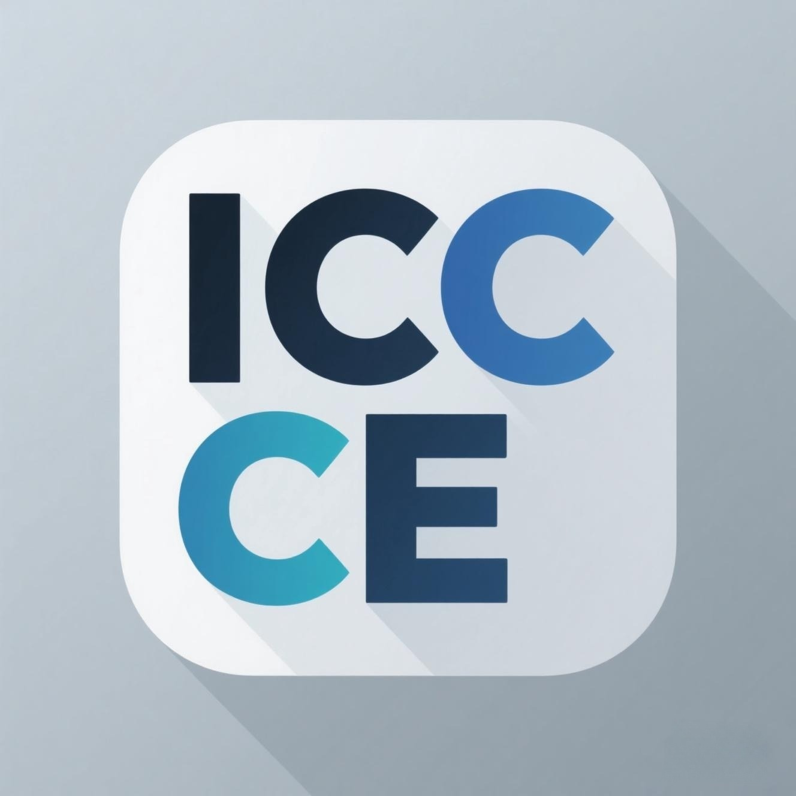

# InkCanvasForClass Community Edition

最后一次基于 `InkCanvas` 控件的倔强...

## 💫 软件说明

使用该版本 InkCanvasForClass，意味着您同意自行承担任何可能存在的问题与风险。建议不要在公众场合（例如公开课、录播课、线上直播课、大型会议）使用未经广泛测试和优化的 Beta 版本，对使用 Beta 版本而带来的任何问题和风险（例如：被班主任批斗、被校长处罚、崩溃而导致的场面混乱、全球海平面上升等），**将由使用者自行承担**，[CJKmkp](https://github.com/CJKmkp) 及其项目的所有维护者不提供任何担保。

♥️ **本项目版权归 [CJKmkp](https://github.com/CJKmkp) 及各位贡献者所有。本项目以 GPL-3.0 发布，不对使用者附加任何额外限制，详见 [License](#license)。**

**智教联盟 InkCanvasForClass Community Edition 板块：** [forum.smart-teach.cn/t/icc-ce](https://forum.smart-teach.cn/t/icc-ce) ，我们会在此处发布版本更新日志，同时，您也可以在遵守论坛对应管理规则与InkCanvasForClass Community Edition 板块管理条约的情况下，在该板块内提问或发表自己的使用体验。

## ⚠️ 使用须知

在使用和分发本软件前，请务必了解相关开源协议。本软件基于 <https://github.com/InkCanvasForClass/icc-20240610-stable> 修改而来，而 icc-20240610-stable 基于 <https://github.com/ChangSakura/Ink-Canvas> 修改，ICA 则基于 <https://github.com/WXRIW/Ink-Canvas> 修改，增加了包括但不限于隐藏到侧边栏等功能，更改了相关UI和软件操作逻辑。对于墨迹书写功能以及 ICA 独有功能的相关问题反馈，建议优先查阅 <https://github.com/WXRIW/Ink-Canvas/issues> 。**使用前建议戴上大脑使用。**

# 💬 提示

- 对于新功能的有效意见和合理建议，开发者会适时回复并进行开发。本软件并非商业性质软件或由营利性机构驱动，请不要催促开发者，耐心等待能让功能少些 Bug，更加稳定。
- 本软件以 GPL-3.0 发布，允许商业使用；如用于商业分发，请遵守 GPL-3.0 的义务（公开对应源代码、保留版权声明等）。更新速度不会很快，如果有能力请通过 PR 贡献代码，而不是在 Issue 里无能狂怒。
- 欢迎尝试 InkCanvas 家族的其他成员，包括 [Ink Canvas Plus](https://khyan.top/ic+) 和 [Ink Canvas Artistry](https://github.com/InkCanvas/Ink-Canvas-Artistry) 。您的大力宣传能让更多用户发现我们的软件。
- **强烈建议使用 Microsoft Office 365 的 PowerPoint 搭配 InkCanvasForClass 使用，效果更好！！！**

## 📗 FAQ

### 在 Windows 10 以下版本系统中，部分图标显示为 「□」 怎么办？

[点击下载](https://aka.ms/SegoeFonts "SegoeFonts") SegoeFonts 文件，安装压缩包中 `SegMDL2.ttf` 字体后重启即可解决。

### 点击放映后一翻页就闪退

请[激活 Microsoft Office](https://www.coolhub.top/archives/14)。

### 放映后画板程序不会切换到 PPT 模式

>[!note]
> 请尝试将PPT联动架构调整为`ROT`或者`VSTO`，如果这不能解决你的问题请参考以下教程。

1. PowerPoint 处在保护模式下（只读），请退出保护模式，方法如下：
   1. 打开 PowerPoint，点击左上角的「文件」选项；
   2. 在「信息」标签内，点击右侧的「启用编辑」按钮。
2. 曾经安装过 WPS Office 办公软件，导致 COM 组件被破坏，解决方法为完全卸载 WPS Office 后重新安装 Microsoft Office Mondo 2016 即可解决。
3. 请确保 PowerPoint 和本应用运行在同一权限下，如果 PowerPoint 以管理员身份运行而本应用以普通用户身份运行，也会出现无法切换到 PPT 模式的现象，您可以通过检查 PowerPoint 的兼容性设置或提权本应用运行来解决该问题。   
4. 如果上述方法不能解决你的问题，请参考这个链接[【点击此处以跳转】](https://www.inkeys.top/tutorial/ppt-com.html)   

### 程序无法正常启动

请检查你的电脑上是否安装了 `.Net Runtime 6.0` 或更高版本。若没有，请[前往官网](https://dotnet.microsoft.com/zh-cn/download/dotnet/6.0)下载安装。

如果仍无法运行，请[安装 `Microsoft Office`](https://www.coolhub.top/archives/11)。

## ✏️ 贡献指南

**请注意，在贡献代码时，_务必_ 将所有代码提交到 _net6_ 分支，以保证net6版本总是新于main版本。**

## Todo LIST

1. 预备 2.0 版本开发
2. Ci 联动插件

## 贡献者

> [!NOTE]
> 此列表通过[All Contributers](https://allcontributors.org/)实现。

<!-- ALL-CONTRIBUTORS-LIST:START - Do not remove or modify this section -->
<!-- prettier-ignore-start -->
<!-- markdownlint-disable -->
<table>
  <tbody>
    <tr>
      <td align="center" valign="top" width="20%"><a href="https://github.com/CJKmkp"> <b>CJK_mkp</b></a> <a href="#maintenance-CJKmkp" title="Maintenance">🚧</a> <a href="https://github.com/InkCanvasForClass/community/commits?author=CJKmkp" title="Documentation">📖</a> <a href="https://github.com/InkCanvasForClass/community/commits?author=CJKmkp" title="Code">💻</a> <a href="#design-CJKmkp" title="Design">🎨</a></td>
      <td align="center" valign="top" width="20%"><a href="https://github.com/CreeperAWA"> <b>CreeperAWA</b></a> <a href="https://github.com/InkCanvasForClass/community/commits?author=CreeperAWA" title="Code">💻</a></td>
      <td align="center" valign="top" width="20%"><a href="https://github.com/2-2-3-trimethylpentane"> <b>2,2,3-三甲基戊烷</b></a> <a href="#blog-2-2-3-trimethylpentane" title="Blogposts">📝</a> <a href="https://github.com/InkCanvasForClass/community/commits?author=2-2-3-trimethylpentane" title="Documentation">📖</a> <a href="#design-2-2-3-trimethylpentane" title="Design">🎨</a> <a href="https://github.com/InkCanvasForClass/community/commits?author=2-2-3-trimethylpentane" title="Tests">⚠️</a> <a href="#tutorial-2-2-3-trimethylpentane" title="Tutorials">✅</a> <a href="#video-2-2-3-trimethylpentane" title="Videos">📹</a></td>
      <td align="center" valign="top" width="20%"><a href="https://github.com/Alan-CRL"> <b>Alan-CRL</b></a> <a href="https://github.com/InkCanvasForClass/community/commits?author=Alan-CRL" title="Code">💻</a> <a href="#infra-Alan-CRL" title="Infrastructure (Hosting, Build-Tools, etc)">🚇</a> <a href="https://github.com/InkCanvasForClass/community/commits?author=Alan-CRL" title="Documentation">📖</a> <a href="#financial-Alan-CRL" title="Financial">💵</a></td>
      <td align="center" valign="top" width="20%"><a href="https://github.com/MKStoler1024"> <b>MKStoler1024</b></a> <a href="https://github.com/InkCanvasForClass/community/commits?author=MKStoler1024" title="Documentation">📖</a> <a href="https://github.com/InkCanvasForClass/community/commits?author=MKStoler1024" title="Code">💻</a> <a href="#design-MKStoler1024" title="Design">🎨</a></td>
    </tr>
    <tr>
      <td align="center" valign="top" width="20%"><a href="https://github.com/awesome-iwb"> <b>Awesome Iwb</b></a> <a href="https://github.com/InkCanvasForClass/community/commits?author=awesome-iwb" title="Documentation">📖</a></td>
      <td align="center" valign="top" width="20%"><a href="https://github.com/PrefacedCorg"> <b>PrefacedCorg</b></a> <a href="https://github.com/InkCanvasForClass/community/commits?author=PrefacedCorg" title="Code">💻</a> <a href="#design-PrefacedCorg" title="Design">🎨</a></td>
      <td align="center" valign="top" width="20%"><a href="http://blog.jursin.top"> <b>Jursin</b></a> <a href="#design-Jursin" title="Design">🎨</a></td>
      <td align="center" valign="top" width="20%"><a href="https://github.com/Tayasui-rainnya"> <b>tayasui rainnya!</b></a> <a href="#design-Tayasui-rainnya" title="Design">🎨</a> <a href="https://github.com/InkCanvasForClass/community/commits?author=Tayasui-rainnya" title="Code">💻</a></td>
      <td align="center" valign="top" width="20%"><a href="https://github.com/doudou0720"> <b>doudou0720</b></a> <a href="https://github.com/InkCanvasForClass/community/commits?author=doudou0720" title="Code">💻</a> <a href="#blog-doudou0720" title="Blogposts">📝</a> <a href="#infra-doudou0720" title="Infrastructure (Hosting, Build-Tools, etc)">🚇</a></td>
    </tr>
    <tr>
      <td align="center" valign="top" width="20%"><a href="https://github.com/PANDAJSR"> <b>PANDAJSR</b></a> <a href="https://github.com/InkCanvasForClass/community/commits?author=PANDAJSR" title="Code">💻</a></td>
      <td align="center" valign="top" width="20%"><a href="http://lyxwx.top"> <b>流焰xwx</b></a> <a href="https://github.com/InkCanvasForClass/community/commits?author=LiuYan-xwx" title="Code">💻</a></td>
      <td align="center" valign="top" width="20%"><a href="https://github.com/Super-Yyt"> <b>Super-Yyt</b></a> <a href="#infra-Super-Yyt" title="Infrastructure (Hosting, Build-Tools, etc)">🚇</a> <a href="#blog-Super-Yyt" title="Blogposts">📝</a></td>
      <td align="center" valign="top" width="20%"><a href="https://github.com/Hao3288"> <b>NoobHao</b></a> <a href="https://github.com/InkCanvasForClass/community/commits?author=Hao3288" title="Code">💻</a></td>
      <td align="center" valign="top" width="20%"><a href="https://github.com/AstrZero"> <b>AstrZero</b></a> <a href="#ideas-AstrZero" title="Ideas, Planning, & Feedback">🤔</a> <a href="https://github.com/InkCanvasForClass/community/commits?author=AstrZero" title="Code">💻</a></td>
    </tr>
    <tr>
      <td align="center" valign="top" width="20%"><a href="http://lrsgzs.top"> <b>lrs2187</b></a> <a href="https://github.com/InkCanvasForClass/community/commits?author=lrsgzs" title="Code">💻</a></td>
      <td align="center" valign="top" width="20%"><a href="http://jbyc.cc"> <b>Jbyccc</b></a> <a href="https://github.com/InkCanvasForClass/community/commits?author=Braydenccc" title="Code">💻</a></td>
      <td align="center" valign="top" width="20%"><a href="http://diann.top"> <b>Nikoa</b></a> <a href="https://github.com/InkCanvasForClass/community/commits?author=diann34" title="Code">💻</a></td>
      <td align="center" valign="top" width="20%"><a href="https://github.com/chenjei2011"> <b>NullptrVoid</b></a> <a href="https://github.com/InkCanvasForClass/community/commits?author=chenjei2011" title="Code">💻</a></td>
      <td align="center" valign="top" width="20%"><a href="https://github.com/wwiinnddyy"> <b>lincube</b></a> <a href="https://github.com/InkCanvasForClass/community/commits?author=wwiinnddyy" title="Code">💻</a></td>
    </tr>
    <tr>
      <td align="center" valign="top" width="20%"><a href="https://github.com/Makitoid"> <b>Makitoid Wang</b></a> <a href="https://github.com/InkCanvasForClass/community/commits?author=Makitoid" title="Documentation">📖</a></td>
      <td align="center" valign="top" width="20%"><a href="https://hhh2309.github.io/"> <b>HHH2309</b></a> <a href="https://github.com/InkCanvasForClass/community/commits?author=HHH2309" title="Code">💻</a></td>
    </tr>
  </tbody>
</table>

<!-- markdownlint-restore -->
<!-- prettier-ignore-end -->

<!-- ALL-CONTRIBUTORS-LIST:END -->

## 🤝 感谢

感谢 [yuwenhui2020](https://github.com/yuwenhui2020) 为 `Ink Canvas 使用说明` 做出的贡献！  
感谢 [CN-Ironegg](https://github.com/CN-Ironegg)、[jiajiaxd](https://github.com/jiajiaxd)、[Kengwang](https://github.com/kengwang)、[Raspberry Kan](https://github.com/Raspberry-Monster)、[clover-yan](https://github.com/clover-yan)、[STBBRD](https://github.com/STBBRD)、[ChangSakura](https://github.com/WuChanging) 为本项目贡献代码！

## 赞助
😻👉 [给CJK捐款谢谢喵](https://www.ifdian.net/a/CJIK_mkp)

## License

本项目以 **GNU General Public License v3.0** 发布，完整许可证文本见 [LICENSE](LICENSE)。

本项目的派生链为：<https://github.com/WXRIW/Ink-Canvas>（InkCanvas 原版）→ <https://github.com/ChangSakura/Ink-Canvas>（ICA）→ InkCanvasForClass → **本仓库 InkCanvasForClass Community Edition**（基于 `icc-20240610-stable` 快照继续开发）。依照 GPL-3.0，我们：

- 保留上游项目及所有贡献者的版权声明；
- 以同一许可证公开完整的对应源代码（即本仓库全部代码）；
- 在本 README 中说明本项目相对上游所作的修改；
- 不对本软件提供任何担保，也不对 GPL-3.0 赋予用户的权利附加任何额外限制。

**版权归属**：本项目代码版权归 [CJKmkp](https://github.com/CJKmkp) 及各位贡献者所有。第三方代码、素材、名称与商标归其各自权利人所有，详见下文「第三方组件」与「相关项目与外部服务」。

## 第三方组件

本项目以 NuGet 包方式引用以下第三方组件，并随程序一同编译分发。下表列出**当前使用**的主要组件；许可证一栏采用 SPDX 标识符，无法从上游确认时标注「见上游 LICENSE」，本表仅为摘要，具体约束以各组件许可证原文为准；完整依赖清单以各项目 `.csproj` 中的 `PackageReference` 为准。

展开第三方组件列表

| 组件 | 许可证 | 用途 |
| :--- | :--- | :--- |
| **[AForge.Imaging](https://github.com/andrewkirillov/AForge.NET) / AForge.Math** | LGPL-3.0 | 图像处理与滤镜 |
| **[CommunityToolkit.Mvvm](https://github.com/CommunityToolkit/dotnet)** | MIT | MVVM 基础设施 |
| **[Costura.Fody](https://github.com/Fody/Costura) / [Fody](https://github.com/Fody/Fody)** | MIT | 程序集打包（IL 织入） |
| **[H.NotifyIcon.Wpf](https://github.com/HavenDV/H.NotifyIcon)** | MIT | 任务栏托盘图标 |
| **[JerryShaw.WPFMediaKit](https://github.com/jerry-shaw/WPF-MediaKit)** | 见上游 LICENSE | 媒体播放控件 |
| **[MdXaml](https://github.com/whistyun/MdXaml)** | MIT | Markdown 渲染 |
| **[MessagePack](https://github.com/MessagePack-CSharp/MessagePack-CSharp)** | MIT | 二进制序列化 |
| **[Microsoft.Extensions.DependencyInjection](https://github.com/dotnet/runtime)** | MIT | 依赖注入 |
| **[Microsoft.Toolkit.Uwp.Notifications](https://github.com/CommunityToolkit/WindowsCommunityToolkit)** | MIT | Toast 通知 |
| **[Microsoft.VisualBasic](https://github.com/dotnet/runtime)** | MIT | .NET 运行时组件 |
| **[NHotkey.Wpf](https://github.com/thomaslevesque/NHotkey)** | MIT | 全局热键 |
| **[Newtonsoft.Json](https://github.com/JamesNK/Newtonsoft.Json)** | MIT | JSON 序列化 |
| **[PDFsharp](https://github.com/empira/PDFsharp)** | MIT | PDF 生成 |
| **[Vortice.Direct2D1 / DXGI / Direct3D11 / DirectComposition](https://github.com/amerkoleci/Vortice.Windows)** | MIT | DirectX 与合成交互 |
| **[WebDav.Client](https://github.com/skazantsev/WebDavClient)** | 见上游 LICENSE | WebDAV 客户端 |
| **[gong-wpf-dragdrop](https://github.com/punker76/gong-wpf-dragdrop)** | 见上游 LICENSE | 拖放行为 |
| **[iNKORE.UI.WPF.Modern](https://github.com/iNKORE-NET/UI.WPF.Modern)**（经派生包引入，详见下节） | iNKORE.UI.WPF.Modern Software License（自定义，非 OSI 认证） | Fluent 风格 UI 控件 |
| **[iNKORE.UI.WPF](https://github.com/iNKORE-NET/UI.WPF)** | LGPL-2.1-or-later | UI 基础设施 |
| **[Fluent System Icons](https://github.com/microsoft/fluentui-system-icons)**（随 iNKORE.UI.WPF.Modern 分发） | MIT | 图标字体 |
| **Microsoft.Office.Interop.PowerPoint / MicrosoftOfficeCore** | 随 Office PIA 分发，权利归 Microsoft | PowerPoint 互操作 |
| **Microsoft.Windows.CsWin32 / Nerdbank.GitVersioning / Microsoft.SourceLink.GitHub / Microsoft.NETFramework.ReferenceAssemblies** | MIT | 仅构建期使用，不随程序分发 |

对各第三方组件的使用不构成对其项目的任何所有权主张。当本项目的许可条款与某第三方组件的许可证存在冲突或不一致时，就相关组件的使用、复制、修改与分发事宜，以相应第三方组件许可证的具体条款为准。

### iNKORE.UI.WPF.Modern

- **Project Name**: iNKORE.UI.WPF.Modern
- **Authors**: iNKORE Studios and all iNKORE.UI.WPF.Modern contributors
- **Repository**: <https://github.com/iNKORE-NET/UI.WPF.Modern>
- **License**: [iNKORE.UI.WPF.Modern Software License](https://github.com/iNKORE-NET/UI.WPF.Modern/blob/main/LICENSE.md)（自定义许可证，非 OSI 认证）

本项目通过组织维护的非官方派生包 **InkCanvasForClass.UI.WPF.Modern** 引用该组件（程序集与命名空间仍为 `iNKORE.UI.WPF.Modern`，代码无需改动）。该派生包由组织在 <https://github.com/InkCanvasForClass/UI.WPF.Modern> 构建并发布，保留上游的 `LICENSE.md`、版权声明与署名信息，未修改许可证条款，也不代表 iNKORE Studios 发布或背书。

### iNKORE.UI.WPF

- **License**: LGPL-2.1-or-later
- **Repository**: <https://github.com/iNKORE-NET/UI.WPF>

### Fluent System Icons（随 iNKORE.UI.WPF.Modern 分发）

- **Copyright**: Copyright (c) 2020 Microsoft Corporation
- **License**: MIT

### Microsoft Tablet PC Ink Analysis

程序通过嵌入资源释放 `IACore.dll`、`IALoader.dll`、`IAWinFX.dll`（Microsoft Tablet PC Ink Analysis 组件，版权归 Microsoft Corporation 所有）。这些文件并非本项目的作品，其权利与许可条款归 Microsoft；本项目仅在运行时按原样释放，不对其进行修改。

### 设计参考

本项目的部分功能与交互设计参考了同类开源项目的公开文档、截图与使用体验（包括 Inkeys、Ink Canvas Plus 等），但**未复制这些项目的源代码**。若相关项目认为某处借鉴不当，可通过 Issue 告知，我们会补充来源说明或调整实现。

## 相关项目与外部服务

### 友情链接

以下项目均为独立项目，与本项目没有代码派生或隶属关系，列出仅为方便用户了解同类软件，不构成任何背书或推荐：

- [Ink Canvas Plus](https://khyan.top/ic+)
- [Ink Canvas Artistry](https://github.com/InkCanvas/Ink-Canvas-Artistry)
- [NamePicker](https://github.com/NamePickerOrg/NamePicker)
- [Inkeys](https://github.com/Alan-CRL/Inkeys)
- [DesktopDrawpadBlocker](https://github.com/Alan-CRL/DesktopDrawpadBlocker)

### 与 Inkeys 项目的关系

[Inkeys（智绘教 Inkeys）](https://github.com/Alan-CRL/Inkeys) 由 Alan-CRL（AlanCRL Studio）独立开发并以 GPL-3.0 发布。本项目与 Inkeys 无隶属关系，也不是 Inkeys 的分支或衍生作品；本仓库不包含 Inkeys 的 C++ 源代码。双方仅在界面与分发层面存在以下对接：

| 位置 | 内容 | 说明 |
| --- | --- | --- |
| 设置 → 友链 | Inkeys 项目入口 | 友情链接，不代表背书 |
| 设置 → 自动化 | “自动查杀 智绘教 Inkeys（仅限新版）”选项 | 退出时结束 `Inkeys.exe` 进程的兼容性选项 |
| 设置 → 自动化 | 选项图标 `Resources/Icons-png/idt.png` | 取自 Inkeys 项目的图标，版权归 AlanCRL Studio 所有 |
| 设置 → 关于 | 贡献者致谢中的 Alan-CRL 头像 | 头像取自其 GitHub 公开资料 |
| 自动更新 | 线路组 `inkeys`，镜像 `https://iccce.inkeys.top` | Inkeys 项目域名下的下载镜像，当前被设为默认优先线路 |
| 文档 | `https://www.inkeys.top/tutorial/ppt-com.html` | PPT 联动教程链接 |

“Inkeys”“智绘教”名称、Inkeys 图标及相关标识归 AlanCRL Studio 所有。本项目仅在指代该软件的范围内使用这些名称与图标，不主张任何权利，也不以 Inkeys 名义发布、推广，或暗示 Inkeys 是本项目的组成部分。若上述名称、图标或镜像的使用未获权利人许可，或权利人认为使用不当，请通过 [Issue](https://github.com/InkCanvasForClass/community/issues) 告知，我们将在核实后立即移除相关内容。

## Star History

<a href="https://www.star-history.com/?repos=InkCanvasForClass%2Fcommunity&type=timeline&logscale=&legend=top-left">
 <picture>
   <source media="(prefers-color-scheme: dark)" srcset="https://api.star-history.com/chart?repos=InkCanvasForClass/community&type=timeline&theme=dark&logscale&legend=top-left&sealed_token=SnZc9WAG-aq5QD6TOSMy6YaCsT1iHHoBEcYjsrbRDjfsVwry1b_A8gwl8LcW8ykN4B5_mjq8snr-_x63pDQ1UzGGXkOdJATbwyoisUdWODvzjrIrfvqEBA" />
   <source media="(prefers-color-scheme: light)" srcset="https://api.star-history.com/chart?repos=InkCanvasForClass/community&type=timeline&logscale&legend=top-left&sealed_token=SnZc9WAG-aq5QD6TOSMy6YaCsT1iHHoBEcYjsrbRDjfsVwry1b_A8gwl8LcW8ykN4B5_mjq8snr-_x63pDQ1UzGGXkOdJATbwyoisUdWODvzjrIrfvqEBA" />
   
 </picture>
</a>